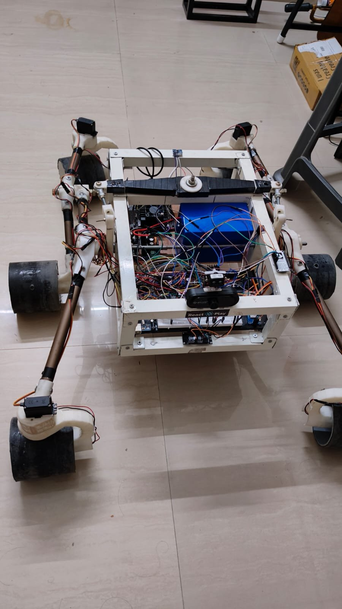
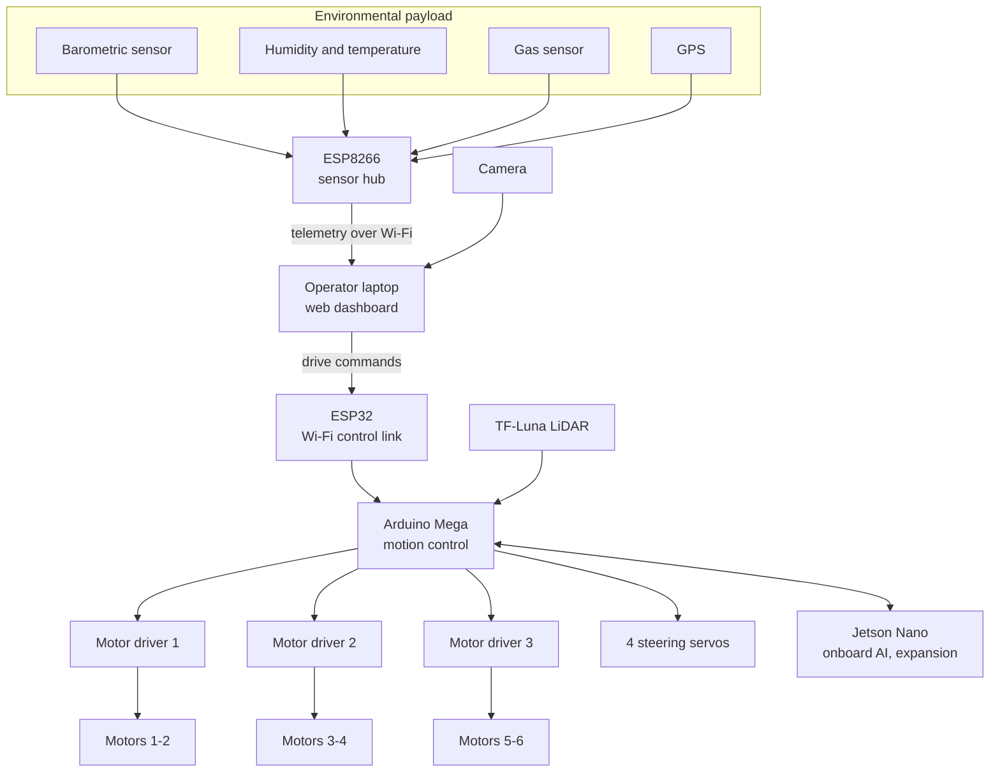
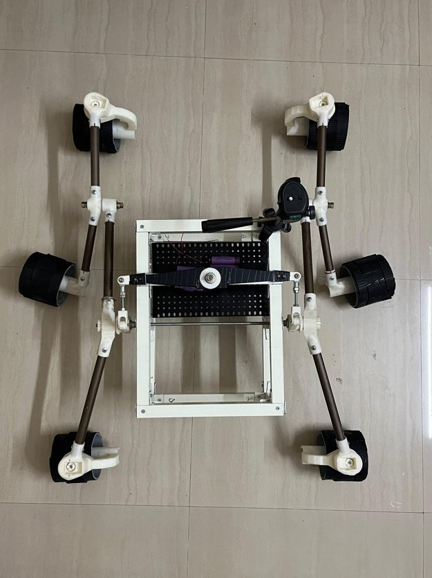
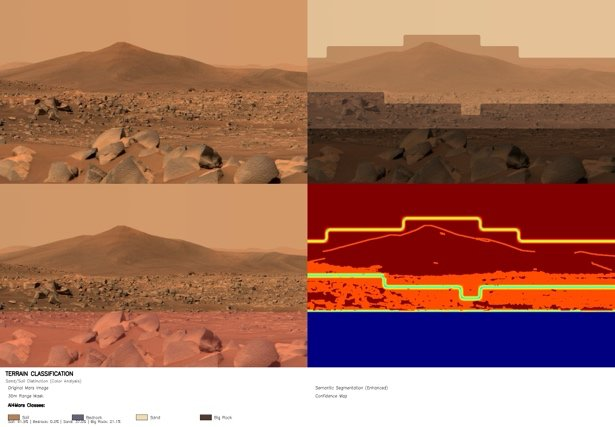
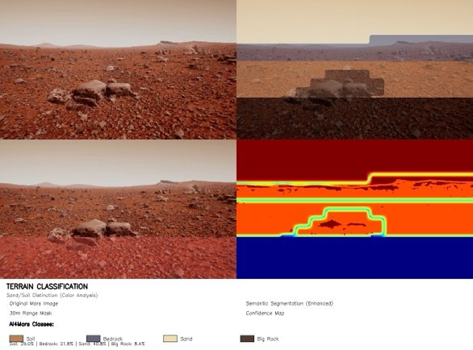
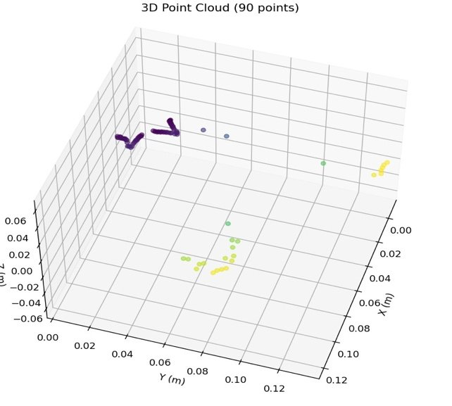
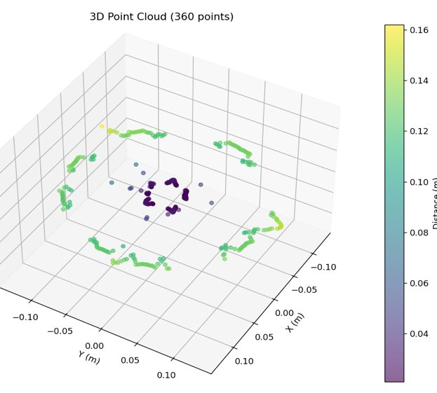
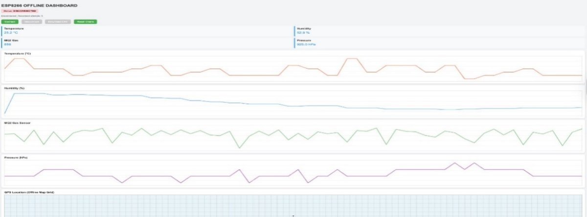
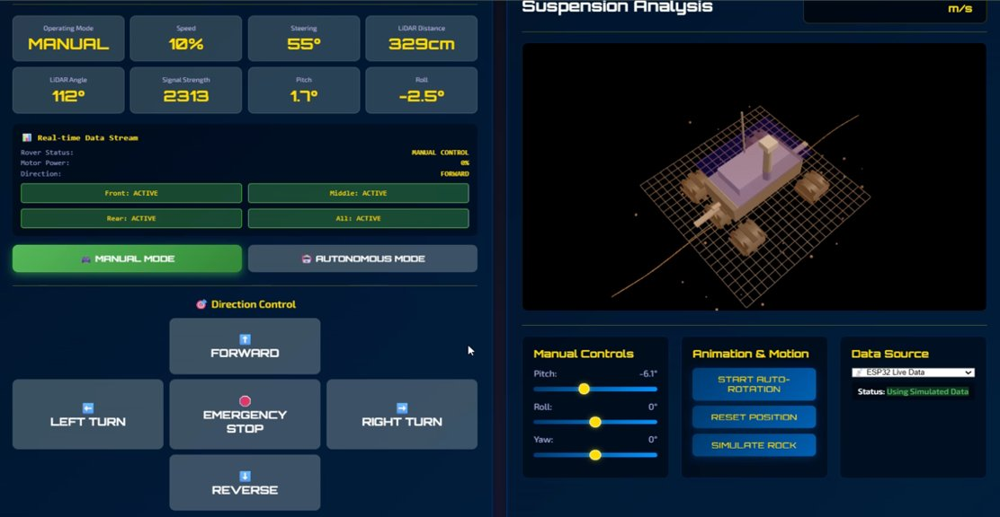
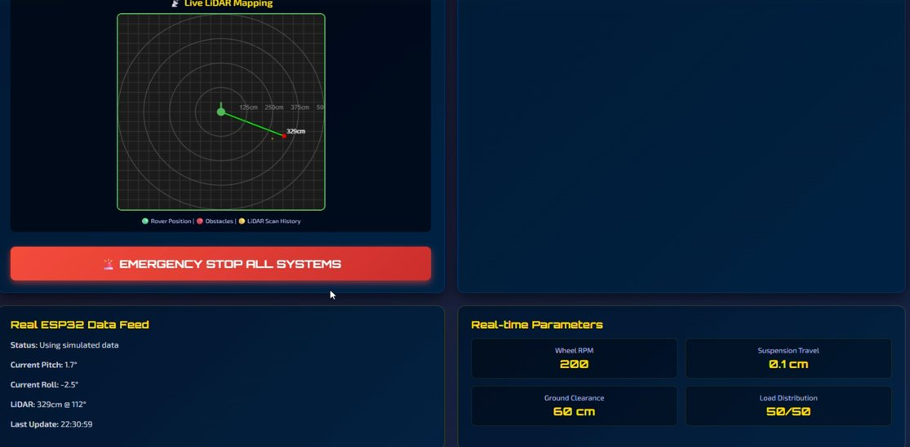

# AI-Based Rough Terrain Rover for Search and Reconnaissance

A semi-autonomous six-wheel rover for uneven, hazardous terrain. It combines a 3D-printed rocker-bogie
chassis, LiDAR terrain mapping, AI terrain classification and an environmental sensing payload, all monitored
and driven from a live web dashboard over Wi-Fi.

  

Final-year engineering group project (team of 4), 2025–26.

## Highlights

* **Rocker-bogie mobility.** Six independently driven wheels on a custom 3D-printed rocker-bogie suspension
  mounted on a lightweight aluminium frame, with four servos for steering. All wheels stay in contact with the
  ground over rocks and slopes.
* **AI terrain classification.** Pixel-wise segmentation of camera images into soil, bedrock, sand and big rock,
  based on an AI4Mars-style segmentation model with CLAHE contrast enhancement, colour-ratio filters, Sobel
  gradients and LBP texture features. **87.5% overall confidence** within a 30 m range.
* **LiDAR terrain mapping.** A TF-Luna time-of-flight LiDAR builds 3D point clouds and radial depth profiles of
  the surroundings, showing obstacles, slopes and depressions.
* **Environmental payload.** Temperature, humidity, barometric pressure, gas, IMU and GPS, streamed live to the
  operator.
* **Web dashboard.** Manual drive controls with emergency stop, live telemetry (speed, steering, LiDAR distance,
  pitch, roll, signal strength), a 3D suspension posture view and a live LiDAR radar map.
* **Semi-autonomous operation.** Operator control over Wi-Fi combined with LiDAR-assisted obstacle awareness.

## System architecture

| Subsystem | Role |
|---|---|
| **Sensing** | An ESP8266 reads the barometric, temperature/humidity, gas and GPS sensors and streams the data to the operator laptop. |
| **Control** | An Arduino Mega runs motion control: it reads the LiDAR, drives six DC motors through three motor drivers and positions four steering servos. |
| **Communication** | An ESP32 carries drive commands from the dashboard to the Arduino Mega over Wi-Fi; the ESP8266 carries telemetry the other way. |
| **Perception** | Camera frames are segmented into terrain classes; LiDAR scans give obstacle distance and surface geometry. |
| **Compute** | An NVIDIA Jetson Nano is integrated for onboard AI and future autonomy. |

## Hardware

| Component | Purpose |
|---|---|
| Custom 3D-printed rocker-bogie chassis on an aluminium frame | Six-wheel suspension for rough terrain |
| 6 × high-torque DC gear motors, 3 × motor drivers | Drive |
| 4 × servo motors | Steering |
| Arduino Mega | Motion control and LiDAR processing |
| ESP32, ESP8266 | Wi-Fi control link, sensor hub |
| NVIDIA Jetson Nano | Onboard AI compute |
| TF-Luna LiDAR | Distance and terrain mapping |
| USB camera | Imaging for terrain classification |
| IMU, GPS | Orientation and localisation |
| Gas, barometric, temperature and humidity sensors | Environmental monitoring |
| Lithium battery pack, buck converters | Power and voltage regulation |

  

## Results

### Terrain classification

Segmentation of Mars-like terrain imagery into four classes. Colour-based enhancement filters corrected
the confusion between soil and bright sand.

| Terrain type | Share of pixels | Pixel count | Confidence |
|---|---|---|---|
| Soil | 1.29% | 11,849 | 65.5% |
| Bedrock | 51.13% | 468,731 | 84.6% |
| Sand | 32.95% | 302,120 | 94.7% |
| Big rock | 14.63% | 134,100 | 83.6% |
| Beyond 30 m (masked) | 30.04% | 393,600 | – |

**Overall confidence within 30 m: 87.5%.** Sand and bedrock are classified most reliably because of their
distinct colour and texture; large rocks are detected with high confidence, which matters for safe paths.

  
  

### LiDAR terrain mapping

The TF-Luna scans produce 3D point clouds (90 and 360 points) that show elevation changes, nearby obstacles
and their approximate distance from the rover.

  
  

### Mobility

In physical tests the rover crossed loose sand, uneven ground, stones and gravel, small rocks, and inclines
and declines. The rocker-bogie suspension kept all wheels on the ground, absorbed vibration and kept the
sensors steady, so readings stayed usable on rough surfaces.

### Dashboard and telemetry

Environmental data plotted live while driving: temperature, humidity, gas level, pressure and GPS position.

  

Drive controls with live telemetry and a 3D view of the rover's posture from IMU pitch and roll:

  

Live LiDAR radar map with an emergency stop for all systems:

  

## Current status and limitations

* The rover is **semi-autonomous**: driving is operator-controlled over Wi-Fi, with LiDAR-assisted obstacle
  awareness. Full autonomous navigation is future work.
* The Jetson Nano is integrated, but its role in this build is minimal because of hardware issues; motion
  control runs on the Arduino Mega.
* The terrain classification results above are on Mars-like terrain imagery.
* The dashboard can also run on simulated data for testing without the rover.

## Future work

* Move terrain classification onto the Jetson Nano for fully onboard perception.
* Autonomous path planning from combined LiDAR geometry and terrain classes.
* SLAM for mapping and localisation in GPS-denied areas.
* Solar charging for longer missions.

## Applications

Search and rescue, disaster-area assessment, hazardous site inspection and planetary surface simulation.

## Recognition

* Rank 11 of 1,054 teams across SAARC, Vishwakarma Awards 2025 (Smart Mobility)
* Presented at CICCS-25

## Author

**Tejas S** · [GitHub](https://github.com/Tejascodz) · [LinkedIn](https://www.linkedin.com/in/tejas-s-57298325a/)

Built as a final-year group project by a team of four.
